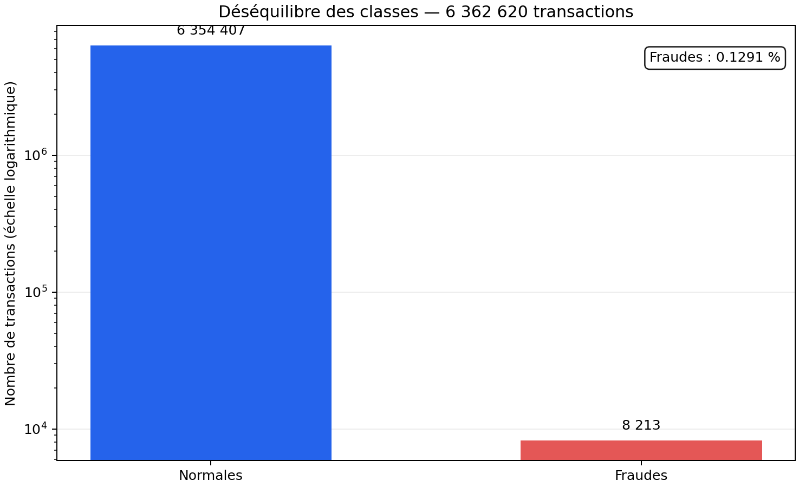
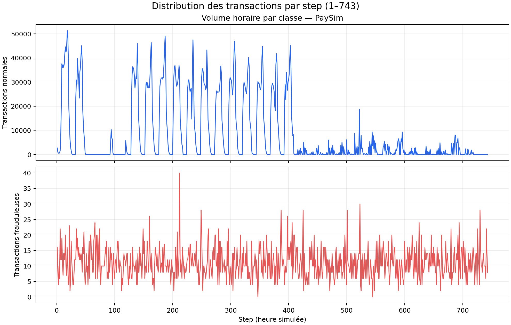
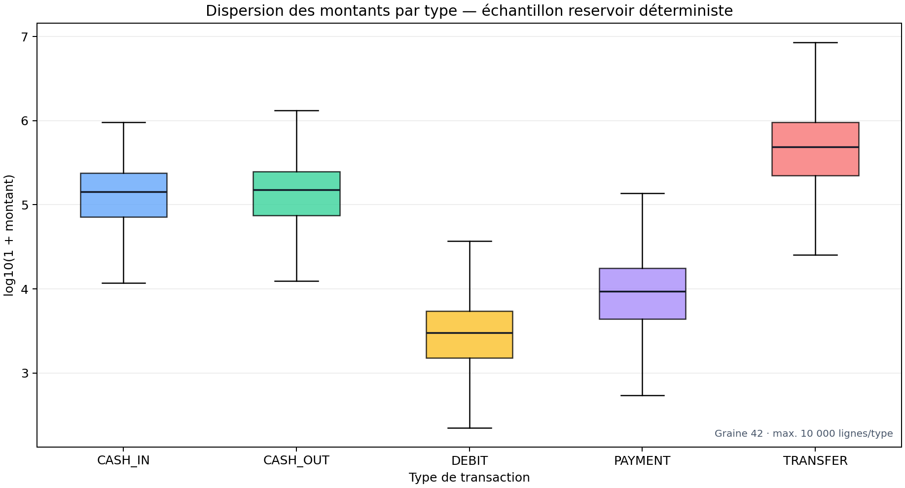
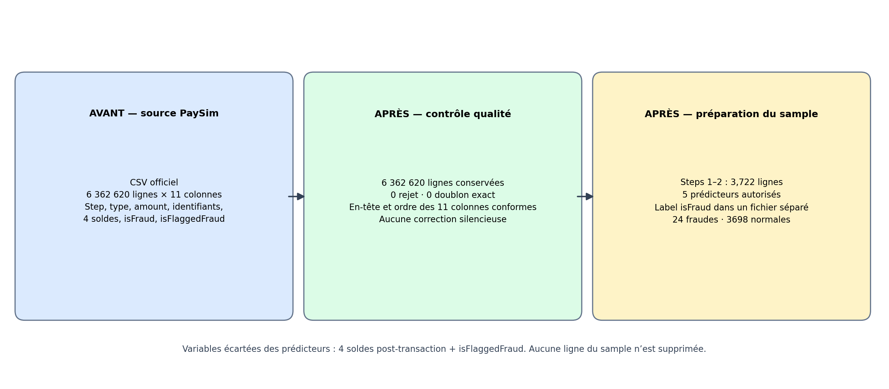

# Analyse exploratoire PaySim — jalon semaine 1

Cette analyse répond au premier objectif du cahier des charges P02 : caractériser la source, contrôler sa qualité, documenter le déséquilibre des classes et fournir un échantillon reproductible. Les comptes complets proviennent de l’audit en flux; le CSV officiel de 493,5 MB reste local.

## Source et méthode

- Jeu de données : [Synthetic Financial Datasets For Fraud Detection (PaySim)](https://www.kaggle.com/datasets/ealaxi/paysim1), par Edgar Lopez-Rojas et collaborateurs.
- Licence indiquée par Kaggle : CC BY-SA 4.0. Le petit échantillon publié dans `data/samples/` conserve cette attribution; le fichier source complet n’est pas distribué.
- Empreinte SHA-256 du CSV audité : `16910f90577b0d981bf8ff289714510bb89bc71bff7d3f220f024e287e4eea6b`.
- Le manifeste complet, y compris les comptes par step et les contrôles de qualité, se trouve dans `../../results/paysim-audit-manifest.json`.

Le fichier contient 6 362 620 lignes et les 11 colonnes attendues. Le contrôle a trouvé zéro ligne rejetée, zéro cellule vide, zéro doublon exact, zéro type inconnu et zéro valeur de solde négative. Seize montants sont nuls. Le domaine temporel réellement observé est step 1–743; aucun enregistrement n’a step 744.

## Déséquilibre des classes

Le fichier comporte 6 354 407 transactions normales et 8 213 transactions frauduleuses. Les fraudes représentent 0,1291 % du total. L’axe vertical est logarithmique afin que les deux classes restent lisibles.

## Distribution temporelle des transactions

Chaque step correspond à une heure simulée. Les deux courbes utilisent les comptes exacts du fichier complet. Les volumes normaux changent fortement au cours de la simulation; les fraudes sont présentes sur une grande partie des steps. Ces résultats justifient de préserver l’ordre temporel et de vérifier la présence des deux classes dans chaque fenêtre ultérieure.

## Dispersion des montants par type

Le graphique compare `amount` par type sur l’échelle `log10(1 + montant)`. Pour garder une consommation mémoire bornée, il utilise un échantillonnage-réservoir déterministe : graine 42 et au plus 10 000 montants par type. Les comptes de classe et par step restent exacts; les quartiles du graphique sont des estimations sur cet échantillon. Les montants de TRANSFER ont une médiane plus élevée, tandis que DEBIT présente des montants plus faibles. Les soldes ne sont pas utilisés dans ce graphique ni dans la future matrice de prédicteurs.

## Avant / après préparation des données

| Étape | Lignes | Colonnes / schéma | Résultat |
|---|---:|---|---|
| CSV officiel avant préparation | 6 362 620 | 11 colonnes sources | Contient les quatre soldes, `isFraud` et `isFlaggedFraud` |
| Après validation de la source | 6 362 620 | 11 colonnes conformes | 0 rejet; aucune ligne ni valeur n’a été supprimée ou modifiée silencieusement |
| Échantillon reproductible, steps 1–2 | 3 722 | 5 prédicteurs autorisés + identifiant d’échantillon | 3 698 normales et 24 fraudes; les deux classes restent présentes |
| Étiquette de l’échantillon | 3 722 | `source_row_id`, `isFraud` | Stockée séparément du fichier de prédicteurs |

La préparation de l’échantillon exclut des prédicteurs les quatre champs de solde et `isFlaggedFraud`; `isFraud` reste une cible séparée pour l’évaluation. Les cinq prédicteurs conservés sont `step`, `type`, `amount`, `nameOrig` et `nameDest`. Aucun rééquilibrage artificiel n’est appliqué.

- Prédicteurs : [`steps_001_002_features.csv`](../../data/samples/steps_001_002_features.csv)
- Étiquettes séparées : [`steps_001_002_labels.csv`](../../data/samples/steps_001_002_labels.csv)
- Résumé avant/après, tailles et empreintes : [`paysim-eda-summary.json`](../../results/paysim-eda-summary.json)

La sélection est reproductible en filtrant toutes les lignes avec `1 <= step <= 2` dans leur ordre source. Le champ `source_row_id` conserve le lien entre la ligne de prédicteurs et son étiquette. Le fichier de prédicteurs ne contient ni `isFraud`, ni soldes, ni `isFlaggedFraud`; l’étiquette reste hors de tout événement Kafka.

## Reproduire les figures et l’échantillon

~~~powershell
python -m pip install -r requirements-eda.txt
python scripts/generate_week1_eda.py "C:\path\to\PS_20174392719_1491204439457_log.csv"
~~~

Le script vérifie la taille et l’empreinte SHA-256 contre le manifeste officiel avant de générer les quatre figures, le résumé JSON et les deux CSV de l’échantillon.

## Limites

PaySim est un jeu synthétique. Ces graphiques décrivent le jeu publié et ne démontrent pas une performance sur des paiements bancaires réels. Aucun découpage train/validation/test ni modèle n’est revendiqué dans ce livrable de semaine 1.
